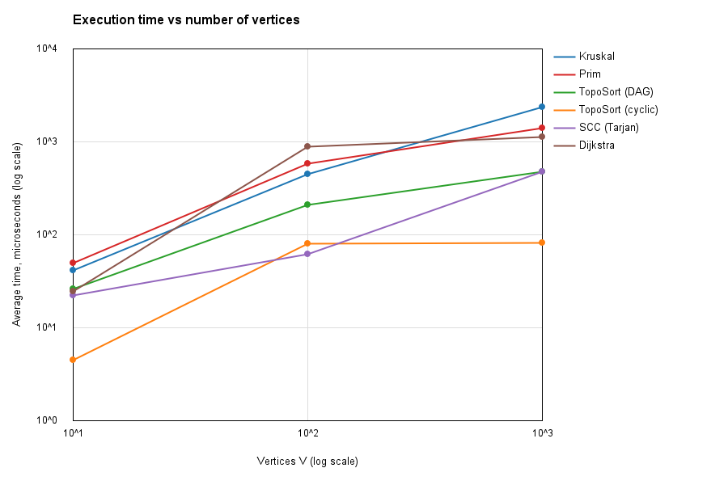
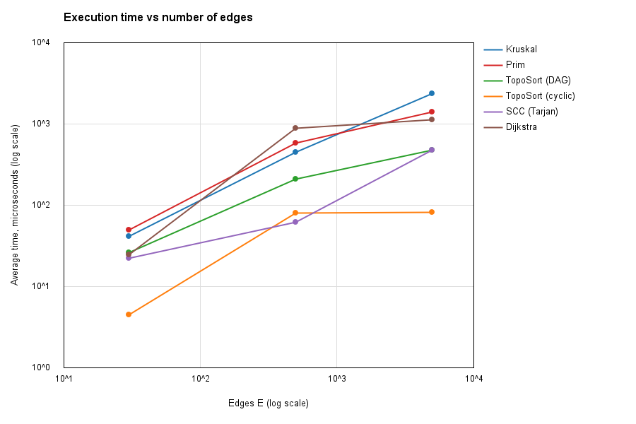
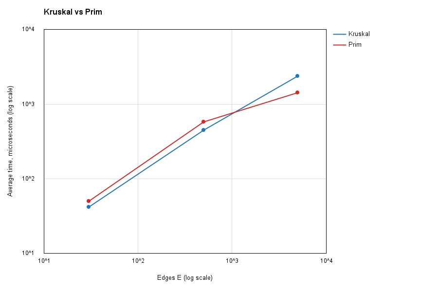

# Assignment 3 — Smart City Infrastructure and Route Planning

**Author:** Arailym Amangeldi (SE-2528)

**Language / build:** Java (compiled with `--release 17`), Maven, no external libraries

A Java application that models a smart city as a graph and solves three planning problems:
building the cheapest road network (MST), analysing one-way connectivity and service
dependencies (topological order, SCC), and finding the shortest routes (Dijkstra).
The project also contains a reproducible benchmark that measures running time and counts
basic operations on graphs of three sizes, and a test suite that checks correctness on
edge cases.

## Contents

1. [Overview](#1-overview)
2. [Implementation](#2-implementation)
3. [Complexity Analysis](#3-complexity-analysis)
4. [Experimental Setup](#4-experimental-setup)
5. [Results](#5-results)
6. [Comparison and Discussion](#6-comparison-and-discussion)
7. [Testing](#7-testing)
8. [Conclusion](#8-conclusion)
9. [How to Build and Run](#9-how-to-build-and-run)

---

## 1. Overview

### Problem model

| Graph concept | City meaning |
|---|---|
| Vertex | a district or location |
| Edge | a road or infrastructure connection |
| Weight | construction cost (MST task) or travel distance (shortest-path task) |
| Directed edge | a one-way road or a dependency between infrastructure services |

### Features

| Task | Algorithm | Purpose |
|---|---|---|
| 1. Infrastructure planning | Kruskal (with DSU), Prim (with priority queue) | cheapest network that connects all districts; connectivity check |
| 2. Connectivity analysis | Kahn topological sort, Tarjan SCC | valid build order for dependencies; detection of cyclic dependencies; groups of mutually reachable districts |
| 3. Route planning | Dijkstra | shortest distances and paths from a source district; unreachable districts |

### Graph representation

The graph is stored as an **adjacency list** (`List<List<Edge>>`) together with a flat
**edge list**.

- `Edge` is an immutable record `(from, to, weight)` with `int` weights.
- For an **undirected** graph each edge is added to both adjacency lists, but it is stored
  **once** in the edge list. Kruskal therefore sees every road exactly once, while Prim and
  Dijkstra can walk the road in both directions.
- For a **directed** graph the edge is added only to the adjacency list of its source.
- Self-loops and parallel edges are never produced by the generators.

An adjacency list uses O(V + E) memory and lets every traversal-based algorithm visit all
edges in O(V + E), which is the right choice for sparse graphs such as road networks
(E = 5V in the large benchmark).

### Project structure

~~~
assignment-3/
├── pom.xml
├── README.md
├── src/
│   ├── graph/          Edge, Graph, GraphGenerator
│   ├── dsu/            DSU
│   ├── mst/            Kruskal, Prim, MSTResult
│   ├── connectivity/   TopologicalSort, SCC
│   ├── shortestpath/   Dijkstra
│   ├── experiments/    Benchmark, PlotWriter
│   └── tests/          TestRunner
└── results/
    ├── tables/         results.md, results.csv, dsu.md
    └── plots/          time_vs_vertices.png, time_vs_edges.png, kruskal_vs_prim.png
~~~

---

## 2. Implementation

### Main design decisions

**DSU (`dsu/DSU.java`)**
- Array-based forest with `parent[]` and `rank[]`.
- `find` is **iterative** (no recursion, so no stack overflow on degenerate chains) and uses
  two-pass **path compression**.
- `union` uses **union by rank** and returns `true` only if two different sets were merged,
  which is exactly what Kruskal needs for cycle detection.
- Path compression and union by rank can be switched off through constructor flags. This is
  used for the ablation experiment in Section 5.3.
- Counters: `find` calls, `union` calls, parent-pointer steps.

**Kruskal (`mst/Kruskal.java`)**
- Sorts a copy of the edge list by weight, then scans edges and keeps an edge if
  `dsu.union(u, v)` succeeds. Stops early once V−1 edges are chosen.
- On a disconnected graph it returns a **minimum spanning forest** and reports
  `connected = false` together with the number of components.

**Prim (`mst/Prim.java`)**
- Lazy version with `java.util.PriorityQueue` (binary heap): all edges leaving the visited
  set are pushed; stale edges (target already visited) are skipped when popped.
- Restarts from every unvisited vertex. Because of this it also returns a spanning forest on
  a disconnected graph, so Kruskal and Prim can be compared on **every** input, including
  disconnected ones.

**Topological sort (`connectivity/TopologicalSort.java`)**
- Kahn's algorithm (repeatedly remove vertices with in-degree 0).
- If fewer than V vertices were removed, the graph contains a cycle: `isDag = false` and no
  order is returned.

**SCC (`connectivity/SCC.java`)**
- Tarjan's algorithm: one DFS with `index[]`, `low[]` and a component stack.
- Implemented recursively. The recursion depth is at most V, which is safe for the V ≤ 1000
  used here (see Limitations).

**Dijkstra (`shortestpath/Dijkstra.java`)**
- Binary heap with **lazy deletion**: instead of decrease-key, an improved distance is pushed
  as a new entry and outdated entries are skipped when popped.
- Rejects negative weights with an `IllegalArgumentException` before the search starts.
- Unreachable vertices keep distance `INF` (`Long.MAX_VALUE`) and have an empty path.
- Returns distances, predecessor array, and `pathTo(v)`.

**Graph generators (`graph/GraphGenerator.java`)**
- `connectedUndirected`: random spanning tree first (guarantees connectivity), then random
  extra edges until E is reached.
- `randomDag`: a random permutation defines a rank for each vertex and every edge goes from
  lower to higher rank, so the graph is acyclic by construction.
- `randomDirected`: edges between random distinct vertices (cycles appear naturally).
- All generators take a **seed**, so every graph is exactly reproducible.

**Operation counters.** Every algorithm returns the number of edge examinations and the
operations specific to it (comparisons counted inside the comparator, DSU `find`/`union`
calls, heap pushes/pops, relaxations). Counters are deterministic, unlike timings.

---

## 3. Complexity Analysis

**Assumptions:** adjacency-list graph, binary heap (`PriorityQueue`), V vertices, E edges,
α = inverse Ackermann function (α(V) ≤ 4 for any realistic V). Time is worst case unless
marked "amortized".

| Algorithm | Time | Space | Notes |
|---|---|---|---|
| DSU `find` / `union` (path compression + union by rank) | O(α(V)) amortized per operation | O(V) | `parent[]`, `rank[]` |
| Kruskal | O(E log E) = O(E log V) | O(V + E) | sorting dominates; the DSU part is O(E · α(V)) |
| Prim (binary heap, lazy) | O(E log E) = O(E log V) | O(V + E) | every undirected edge is pushed exactly once, so the heap holds at most E entries |
| Topological sort (Kahn) | O(V + E) | O(V) | every vertex and edge is processed once |
| SCC (Tarjan) | O(V + E) | O(V) | one DFS; recursion stack up to V |
| Dijkstra (binary heap, lazy deletion) | O((V + E) log V); with lazy deletion O(E log E) | O(V + E) | requires non-negative weights |

(log E = O(log V) because E ≤ V², so log E ≤ 2 log V.)

### How V and E affect performance

- **DSU:** V only sets the array size. Cost depends on the number of operations, which is
  O(E) when used by Kruskal.
- **Kruskal:** runtime is dominated by sorting E edges, so it is driven by **E**. V matters
  only through DSU size and the early stop after V−1 edges. Kruskal is the natural choice
  when the edges are already a list and the graph is sparse.
- **Prim:** every edge enters the heap once, so it is also driven by **E log V**, plus O(V)
  for visiting vertices. With an adjacency list it examines each undirected edge twice.
- **Kahn and Tarjan:** strictly linear in **V + E**; doubling the graph roughly doubles the
  time.
- **Dijkstra:** O(E log V). Each successful relaxation causes one heap push, and every push
  or pop costs O(log V). The number of successful relaxations is at most E.

### Why DSU optimizations help

Without optimizations a sequence of unions can build a **chain** of depth V, so one `find`
costs O(V). Then n finds cost O(n²).

- **Union by rank** always attaches the shallower tree under the deeper one. A tree of
  height h has at least 2^h nodes, so the height never exceeds log₂ V.
- **Path compression** makes every node on the traversed path point directly to the root.
  Later finds on those nodes cost O(1).
- Together they give O(α(V)) amortized time per operation (Tarjan, 1975).

Measured evidence is in [Section 5.3](#53-dsu-ablation).

### Why Dijkstra fails with negative weights

Dijkstra **finalizes** a vertex the moment it is removed from the heap. This is correct only
if every other path to that vertex must be at least as long, which holds when extending a
path can never make it shorter, i.e. when all weights are non-negative.

With a negative edge this breaks. Example graph:

~~~
s -> a (2),  s -> b (3),  b -> a (-2),  a -> c (1)
~~~

Dijkstra removes `a` with distance 2 and finalizes it, then relaxes `c` to 3. Later it
reaches `b` and finds the shorter route to `a` (3 − 2 = 1), but `a` is already finalized,
so `c` is never improved. The true shortest distance to `c` is 3 − 2 + 1 = **2**, while
Dijkstra reports **3**. The algorithm for graphs with negative edges is Bellman-Ford,
O(V · E). This implementation therefore throws an exception on negative weights instead of
silently returning wrong results.

---

## 4. Experimental Setup

### Graph configurations

| Name | Vertices (V) | Edges (E) |
|---|---|---|
| Small | 10 | 30 |
| Medium | 100 | 500 |
| Large | 1,000 | 5,000 |

### Generation

- Random source: `java.util.Random` with the fixed seed `42 + i` (`i` = 0, 1, 2 for
  Small, Medium, Large). The same seed always produces the same graph.
- Edge weights: random integers in [1, 100]. This produces duplicate weights, so graphs with
  several valid MSTs are part of the experiments.
- No self-loops, no parallel edges.

| Experiment | Graph used | How it is generated |
|---|---|---|
| Kruskal, Prim | undirected, **connected** | random spanning tree + random extra edges; connectivity is guaranteed by construction (confirmed: `connected = true` for all three sizes) |
| Dijkstra | the same undirected connected graph (roads are two-way), source = vertex 0 | as above |
| Topological sort (DAG) | directed, **acyclic** | random vertex ranking; every edge goes from lower to higher rank (confirmed acyclic for all three sizes) |
| SCC and topological sort (cyclic) | directed, **with cycles** | edges between random distinct vertices. The generated graphs have **1, 4 and 18 SCCs** for V = 10, 100, 1000. Since the number of SCCs is smaller than V in every case, all three graphs contain cycles. The Small graph is a single SCC (every district can reach every other one). |

### Measurement procedure

- Time: `System.nanoTime()` around a single algorithm call; results are reported in
  **microseconds**.
- **20 warm-up runs** per measurement (not recorded) to let the JIT compiler optimize the
  code before timing starts.
- **5 measured repetitions** per algorithm and graph size; the table shows the **average**.
- Graph generation is excluded from the timed region.
- Operation counts are deterministic (identical on every run).
- Environment: AMD Ryzen 7 7735HS (3.20 GHz), 16 GB RAM, Windows 11 (version 26H2), JDK 25.0.3 (project compiled with `--release 17`).
---

## 5. Results

### 5.1 Execution time and operation counts

| Algorithm | Graph | V | E | Avg time (us) | Operation counts |
|---|---|---|---|---|---|
| Kruskal | Small | 10 | 30 | 41.86 | examined=15, sortCmp=109, dsuOps=45, weight=134 |
| Prim | Small | 10 | 30 | 50.34 | examined=60, heapCmp=204, heapOps=60, weight=134 |
| TopoSort (DAG) | Small | 10 | 30 | 26.60 | examined=30, isDag=true, processed=10 |
| TopoSort (cyclic) | Small | 10 | 30 | 4.58 | examined=0, isDag=false, processed=0 |
| SCC (Tarjan) | Small | 10 | 30 | 22.30 | examined=30, components=1 |
| Dijkstra | Small | 10 | 30 | 24.86 | examined=60, relaxations=17, pushes=18, pops=18, cmp=79 |
| Kruskal | Medium | 100 | 500 | 450.74 | examined=292, sortCmp=3844, dsuOps=876, weight=1301 |
| Prim | Medium | 100 | 500 | 583.38 | examined=1000, heapCmp=7661, heapOps=1000, weight=1301 |
| TopoSort (DAG) | Medium | 100 | 500 | 213.62 | examined=500, isDag=true, processed=100 |
| TopoSort (cyclic) | Medium | 100 | 500 | 81.44 | examined=15, isDag=false, processed=2 |
| SCC (Tarjan) | Medium | 100 | 500 | 62.54 | examined=500, components=4 |
| Dijkstra | Medium | 100 | 500 | 891.02 | examined=1000, relaxations=197, pushes=198, pops=198, cmp=2386 |
| Kruskal | Large | 1000 | 5000 | 2367.56 | examined=3629, sortCmp=50356, dsuOps=10887, weight=12002 |
| Prim | Large | 1000 | 5000 | 1421.90 | examined=10000, heapCmp=110757, heapOps=10000, weight=12002 |
| TopoSort (DAG) | Large | 1000 | 5000 | 479.58 | examined=5000, isDag=true, processed=1000 |
| TopoSort (cyclic) | Large | 1000 | 5000 | 83.40 | examined=46, isDag=false, processed=9 |
| SCC (Tarjan) | Large | 1000 | 5000 | 480.24 | examined=5000, components=18 |
| Dijkstra | Large | 1000 | 5000 | 1137.48 | examined=10000, relaxations=1945, pushes=1946, pops=1946, cmp=35848 |

Generation checks printed by the benchmark:

- Small: connected = true, Kruskal weight = 134, Prim weight = 134, equal = true; directed graph has 1 SCC; DAG graph is acyclic.
- Medium: connected = true, Kruskal weight = 1301, Prim weight = 1301, equal = true; directed graph has 4 SCCs; DAG graph is acyclic.
- Large: connected = true, Kruskal weight = 12002, Prim weight = 12002, equal = true; directed graph has 18 SCCs; DAG graph is acyclic.

Notes about the counters:
- `examined` is the number of edge examinations.
- `sortCmp` and `heapCmp` are comparisons performed by the sort / the priority queue.
- `dsuOps` is the number of `find` plus `union` calls; each examined edge costs exactly one
  `union` call and two `find` calls inside it, so `dsuOps = 3 · examined`
  (45 = 3·15, 876 = 3·292, 10887 = 3·3629).
- `heapOps` (Prim) is pushes plus pops.

### 5.2 Plots

Both axes are logarithmic so that sizes from 10 to 1,000 and times that span several orders
of magnitude fit on one chart.

**Execution time vs number of vertices**

**Execution time vs number of edges**

**Kruskal vs Prim**

### 5.3 DSU ablation

Test: `n = 20,000`, perform `union(i, i+1)` for all i (builds the worst-case chain without
rank), then `find(i)` for every i. "Parent steps" counts pointer hops inside `find`.

| DSU variant | n | Time (ms) | Parent-pointer steps |
|---|---|---|---|
| naive (no compression, no rank) | 20000 | 482.74 | 199990000 |
| path compression only | 20000 | 2.10 | 39997 |
| union by rank only | 20000 | 1.31 | 39997 |
| path compression + union by rank | 20000 | 0.59 | 39997 |

---

## 6. Comparison and Discussion

### A note on reading the timings

Every measurement is the average of only 5 runs after 20 warm-up runs, and the numbers are in
microseconds, so they are sensitive to JIT compilation, garbage collection and timer
resolution. The Medium row in particular is larger than a smooth trend between Small and
Large would suggest (for example Dijkstra grows 36× from Small to Medium but only 1.3× from
Medium to Large). The most likely reason is that the JIT compiler is still optimizing the code
at the Medium size, which is a measurement artefact rather than an algorithmic effect.
The **operation counts are deterministic**, so the comparisons below rely on them first and on
the timings second.

### Kruskal vs Prim

Both algorithms returned **the same total weight** on every graph (134, 1301 and 12002), as
expected: the MST weight is unique even when several different MSTs exist.

| Counter (Large graph) | Kruskal | Prim |
|---|---|---|
| Edge examinations | 3,629 | 10,000 |
| Comparisons | 50,356 (sorting) | 110,757 (heap) |
| Other work | 10,887 DSU operations | 10,000 heap operations |

- **Prim** examines every undirected edge from both endpoints, so `examined = 2E` exactly
  (60, 1,000, 10,000). Every edge is pushed once and popped once, so `heapOps = 2E` as well.
- **Kruskal** sorts all E edges (`sortCmp` is slightly below E·log₂E: 109 vs 147, 3,844 vs
  4,483, 50,356 vs 61,438) and then scans the sorted list only until V−1 edges are chosen.
  It therefore examines only 50%, 58% and 73% of the edges for the three sizes. The larger
  the graph relative to its MST, the more edges the early stop saves.
- **Timing:** Kruskal was faster on Small (41.86 vs 50.34 µs, 1.2×) and Medium (450.74 vs
  583.38 µs, 1.3×), but Prim was faster on Large (1421.90 vs 2367.56 µs, 1.7×). The counters
  predict the opposite for Large (Kruskal performs fewer examinations and about half the
  comparisons), so this result should not be read as "Prim is asymptotically faster". Both
  algorithms are O(E log V), and the difference is within what constant factors and JIT
  state can explain: Kruskal copies and sorts 5,000 `Edge` objects through a comparator,
  and its Large time grew only 5.3× over Medium, which suggests that code was not fully
  optimized yet during the measured runs. A longer warm-up would be needed to settle the
  question.

### DSU

The naive DSU (no path compression, no union by rank) turns the chain of unions into a path
of depth n, so the finds cost n(n−1)/2 = 199,990,000 parent-pointer steps for n = 20,000 and
take 482.74 ms (see Section 5.3). Every optimized variant needs only 39,997 steps, about
5,000 times fewer.

Two details of this experiment are worth stating:

- "Union by rank only" and "path compression only" give the same step count (39,997) on
  this particular test. With union by rank, the sequence `union(i, i+1)` always attaches the
  new single vertex under the existing root, so it builds a star instead of a chain. On
  other union sequences the variants differ: union by rank guarantees tree height O(log n)
  in the worst case, while path compression flattens paths and gives the amortized bound.
  Only the combination of both gives O(α(V)).
- The step counts are deterministic and are the reliable metric. The times of the optimized
  variants (2.10, 1.31 and 0.59 ms) come from a single run without warm-up, so the ranking
  among them should not be over-interpreted. The difference to the naive variant (482.74 ms)
  is large enough to be meaningful.

This matches the theory: without optimizations one `find` can cost O(V), with both
optimizations the amortized cost is O(α(V)), which is practically constant.

Inside Kruskal the DSU is cheap: it performs exactly three operations per examined edge
(one `union` call, which makes two `find` calls), so `dsuOps = 3 · examined`, and with both
optimizations each of them takes nearly constant time.

### SCC: growth with graph size

Tarjan examines every edge exactly once (`examined = E`: 30, 500, 5,000), so the work is
linear in V + E, which grows 15× from Small to Medium (40 → 600) and 10× from Medium to
Large (600 → 6,000). The measured time grew 2.8× (22.30 → 62.54 µs) and then 7.7×
(62.54 → 480.24 µs). On the small graphs the time is dominated by fixed overhead, so the
first step is much smaller than 15×; the Medium → Large step (7.7× for a 10× larger graph)
is close to the linear prediction.

### Topological ordering: DAGs vs cyclic graphs

| Graph | Size | `examined` | `processed` | `isDag` |
|---|---|---|---|---|
| DAG | Small / Medium / Large | 30 / 500 / 5,000 | 10 / 100 / 1,000 | true |
| Cyclic | Small / Medium / Large | 0 / 15 / 46 | 0 / 2 / 9 | false |

- On **DAGs** Kahn's algorithm processes all V vertices and all E edges and returns a valid
  order (checked by the tests for every edge).
- On **cyclic graphs** the vertices on a cycle never reach in-degree 0, so `processed < V`
  and `isDag = false`; no order is returned. In the Small graph no vertex has in-degree 0,
  so nothing is processed at all (`processed = 0`); in the Medium and Large graphs only 2 and
  9 vertices could be removed before the algorithm got stuck at the cycles.
- Because it stops early, detecting a cycle is much cheaper than ordering a DAG: 83.40 µs
  vs 479.58 µs on the Large graph.

### Dijkstra

On the connected undirected graph every vertex is settled once and all adjacency lists are
scanned, so `examined = 2E` exactly (60, 1,000, 10,000).

The heap work is much smaller than the worst case. The number of successful relaxations is
only 17, 197 and 1,945 (about 2V, and 39% of E on the Large graph), so there are only 18, 198
and 1,946 heap pushes, and the same number of pops. The comparison count grows from 79 to
2,386 to 35,848 (30× and 15×), consistent with E log V growth. The measured time
(24.86 → 891.02 → 1,137.48 µs) is affected by the warm-up effect described above. On Medium
and Large, Dijkstra and Prim have the same order of magnitude (891 vs 583 µs and 1,137 vs
1,422 µs), as expected for two heap-based algorithms on the same graph.

### Theory vs practice

- The **operation counts match the theory exactly**: `examined = E` for Kahn and Tarjan,
  `examined = 2E` for Prim and Dijkstra, `dsuOps = 3 · examined` for Kruskal, and
  `sortCmp` just below E·log₂E. The implementations do what the analysis assumes.
- The comparison counts of the heap-based algorithms grow by 14.5× (Prim) and 15× (Dijkstra)
  from Medium to Large while E grows 10×, which is the expected extra log factor.
- For the **Small** graph the runtime is a few to a few dozen microseconds, dominated by
  constant overheads, and does not show an asymptotic trend.
- Measured times for Medium and Large deviate from the ideal curves because of JIT warm-up
  and GC; the deterministic counters are the reliable evidence for the complexity analysis.

---

## 7. Testing

All tests live in `src/tests/TestRunner.java` and run without any external library. Each
check prints `[PASS]` or `[FAIL]`; the program exits with code 1 if any check fails.

| Required case | Test | What is verified |
|---|---|---|
| Small graphs | known 4-vertex graph | MST weight 6 for both Kruskal and Prim; both report connected |
| Disconnected graphs | 5 vertices, two components | `connected = false`, 2 components, both return the same forest weight 6 |
| Graphs containing cycles | pure cycle 0→1→2→0, and a cycle inside a larger graph | topological sort reports `isDag = false` |
| Multiple valid MSTs | triangle and 4-cycle with all equal weights | Kruskal and Prim give the same weight (2 and 15) |
| Unreachable vertices | Dijkstra on a graph with an isolated vertex | vertex reported unreachable with an empty path |
| Duplicate edge weights | 200 random graphs with weights in {1, 2, 3} | Kruskal weight equals Prim weight on every graph |
| Single vertex | one-vertex graph | MST weight 0 and connected, topological order [0], exactly one SCC, Dijkstra distance 0 |

Additional correctness checks:

| Property from the assignment | Test |
|---|---|
| Kruskal and Prim return the same MST weight on connected undirected weighted graphs | 50 random connected graphs of growing size |
| The MST is a valid tree | both results have V−1 edges and adding them one by one to a DSU never closes a cycle |
| Topological ordering is valid for every DAG | 50 random DAGs: for every edge (u, v), `position[u] < position[v]` |
| Every vertex belongs to exactly one SCC | 30 random directed graphs: each vertex appears in exactly one component |
| SCC correctness | known graph gives {0,1,2}, {3,4}, {5}; a DAG gives V singleton components |
| Dijkstra returns correct shortest distances | on 30 random graphs the result equals an independent Bellman-Ford implementation; the known-graph test also checks the path 0→2→1→3 |
| Negative weights are rejected | `Dijkstra.run` throws `IllegalArgumentException` |
| DSU | `union`/`find`/`connected`/component count |

Result of the last run:  "Passed: 31, Failed: 0"

---

## 8. Conclusion

- **Planning the network.** Both Kruskal and Prim find the same minimum-cost network in
  O(E log V) (weights 134, 1301 and 12002 on the three graphs). Kruskal is simple, needs
  fewer examinations thanks to its early stop (73% of the edges on the Large graph) and is a
  good fit when the edges are available as a list or the graph is sparse; Prim works
  directly on adjacency lists and is preferable when the graph is dense or stored as an
  adjacency structure. Both detect disconnected districts.
- **DSU.** Path compression with union by rank makes connectivity queries nearly constant
  time and is what keeps Kruskal fast; the ablation shows the naive version degrading
  quadratically.
- **Dependencies and connectivity.** Kahn's algorithm gives a valid build order for service
  dependencies and detects cyclic dependencies in O(V + E), and stops early when it finds
  one. Tarjan's algorithm finds all groups of mutually reachable locations (SCCs) in a single
  linear pass: 1, 4 and 18 components on the three test graphs.
- **Routing.** Dijkstra with a binary heap is the right tool for shortest routes when all
  distances are non-negative. With negative weights Bellman-Ford must be used instead.
- **Measured results.** The linear-time algorithms (Kahn, Tarjan) were the fastest on the
  Large graph (about 480 µs each), followed by Dijkstra, Prim and Kruskal, which pay the
  extra log factor for heap or sorting work. The deterministic operation counts agree with
  the theoretical complexities, while the wall-clock times on small inputs are noisy
  because of JIT warm-up.

### Limitations

- SCC uses recursion; for graphs much larger than the tested V ≤ 1,000 an iterative version
  would be needed to avoid stack overflow.
- Edge weights are 32-bit integers; path lengths and MST weights are accumulated in `long`.
- Timing results depend on the machine and JVM state; operation counts do not. With only 5
  repetitions and microsecond-scale runs, timings contain noticeable noise (see Section 6).
- Only the three required sizes were benchmarked; the plots therefore contain three points
  per algorithm.

---

## 9. How to Build and Run

**Requirements:** JDK 17. Maven is optional (IntelliJ IDEA has it built in).

### IntelliJ IDEA

1. Open the project folder, wait until Maven finishes importing.
2. Run `src/tests/TestRunner.java` (green arrow next to `main`) to execute all tests.
3. Run `src/experiments/Benchmark.java` to execute the experiments.
   The working directory must be the project root so that results are written to `results/`.

### Command line (Maven installed)

~~~bash
mvn clean compile
mvn -q exec:java "-Dexec.mainClass=tests.TestRunner"   # all correctness tests
mvn -q exec:java                                       # benchmark, writes results/
~~~

### Command line (JDK only)

~~~bash
mkdir out
javac -d out $(find src -name "*.java")
java -cp out tests.TestRunner
java -cp out experiments.Benchmark
~~~

### Reproducibility

All graphs are generated from fixed seeds (`42`, `43`, `44`), so tables of operation counts
are identical on every run. Timings vary slightly with the machine; they are averaged over
5 runs after 20 warm-up runs.